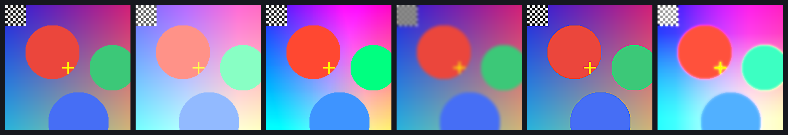

# pizzart

MIT — vedi [LICENSE](LICENSE). Copyright (c) 2025 Marco Razzano.

Editor grafico in Rust: un motore 2D proprio (compositing, disegno, testo,
maschere, effetti) e un'interfaccia minimale ma usabile. Non è un port di
nessun'altra applicazione: è un editor progettato da zero, senza pubblicità,
abbonamenti o telemetria.



## Stato

| Crate | Cosa fa | Test |
|---|---|---|
| `pizzart-core` | documento ad albero, 12 blend, maschere, selezione, storia, id stabili | 99 + 19 |
| `pizzart-draw` | pennello con pressione e inclinazione, tessera ritagliata | 22 |
| `pizzart-text` | registro font, layout, rasterizzazione in tessera | 14 |
| `pizzart-render` | compositing wgpu, 6 effetti, parità CPU/GPU verificata | 55 |
| `pizzart-io` | export PNG / JPEG / WebP | 13 |
| `pizzart-project` | salvataggio: zip, manifest JSON, Zstd | 14 |
| `pizzart-ui` | interfaccia egui: canvas, pannelli, strumenti | 17 |

**251 test**, CI su Windows/Linux/macOS, `clippy -D warnings` e `rustfmt` come gate.
MSRV dichiarato: **1.88** (serve a `as_chunks`, usato nel motore).

## Build e test

Prerequisiti: Rust stable, e su Windows i Visual Studio Build Tools (workload
"Desktop development with C++": servono a `zstd-sys` e a wgpu).

```bash
# Test (nessuna GPU richiesta, veloce)
cargo test -p pizzart-core -p pizzart-draw -p pizzart-text -p pizzart-io -p pizzart-project

# Test con GPU (parità CPU/GPU, lento)
cargo test -p pizzart-render -p pizzart-ui

# Editor
cargo run --release -p pizzart-ui
```

`Cargo.lock` è committato deliberatamente: è un'applicazione, la build deve essere
riproducibile. Prima build 3-8 minuti, poi in cache.

## Posizione sul progetto originale

Pizzart è un editor **clean-room**: l'analisi di un'applicazione concorrente
(materiale in `_estrazione/`, fuori dal repository) è servita esclusivamente come
**capitolato funzionale** — quali schermate, quali effetti, quali strumenti un
utente si aspetta. Non è stato tradotto né riusato codice, non sono stati copiati
asset (icone, font, texture), non è stata replicata l'interfaccia pixel per pixel.
Le specifiche in `docs/spec/` sono **fatti aggregati** (quanti effetti, quante
famiglie), non dump di stringhe originali; il CI lo verifica a ogni push con
`tools/check_spec_no_dump.py`.

## Documentazione

- [`docs/ARCHITECTURE.md`](docs/ARCHITECTURE.md) — decisioni strutturali (formato pixel, memoria, renderer)
- [`docs/DEVLOG.md`](docs/DEVLOG.md) — come è stato costruito, con numeri e note di progetto
- [`docs/REPORT_UI_20261025.md`](docs/REPORT_UI_20261025.md) — audit dell'interfaccia: 10 bug, misure, priorità
- [`docs/FASE_1_CHIUSA.md`](docs/FASE_1_CHIUSA.md) — cosa è stato chiuso e cosa resta
- [`MANUAL_TEST.md`](MANUAL_TEST.md) — checklist di verifica manuale
- [`docs/spec/`](docs/spec/) — specifiche aggregate del dominio
